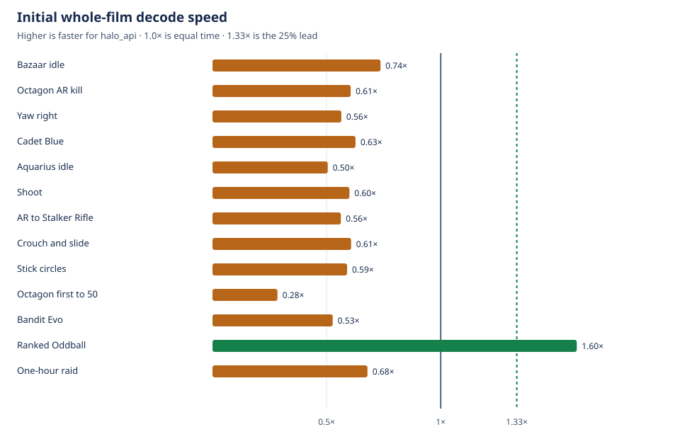
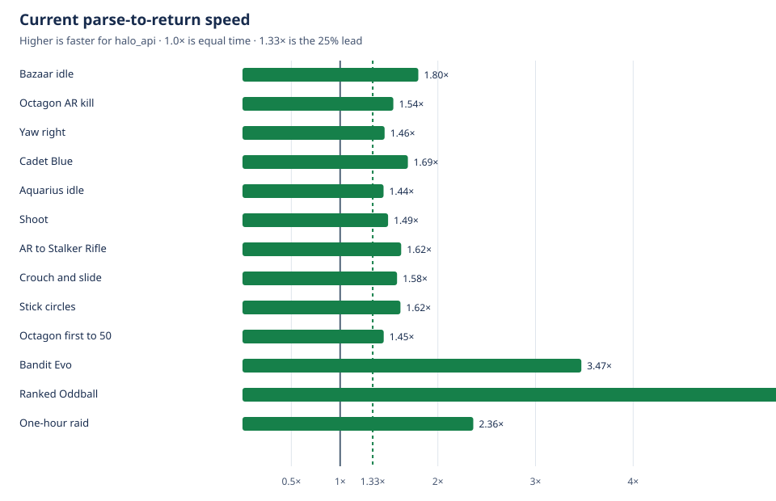

# Film decode benchmark — 2026-11-18

Run from the repository root:

```sh
cargo run --release --manifest-path benchmarks/film_decode/Cargo.toml -- \
  tests/fixtures/theater/bazaar_idle \
  tests/fixtures/theater/octagon_ar_kill
```

The two larger recordings below are local and ignored by Git. To repeat those
runs, supply your own film directories containing `film.json` or `manifest.json`
and the referenced chunk files.

The baseline used halo_api `13028a74`, libfilmshell `031e2179`, Rust 1.98.1,
arm64 macOS 26.7.1, release `opt-level=3`, without LTO. Source files are read
before timing. Each decode receives a fresh owned copy of every compressed
chunk. Already-inflated local files are recompressed once before timing. The
median is reported over 15 runs for small films and 5 runs for larger ones.
Set `FILM_BENCH_RUNS` to override the run count.

| Film | Compressed input | halo_api `Film::parse` | halo_api inflation alone | libfilmshell `Film::from_chunks` | halo_api / libfilmshell |
| --- | ---: | ---: | ---: | ---: | ---: |
| Bazaar idle | 0.52 MiB | 79.7 ms | 12.3 ms | 27.3 ms | 2.92× |
| Octagon AR kill | 0.51 MiB | 81.1 ms | 15.4 ms | 25.9 ms | 3.13× |
| Bandit Evo | 8.30 MiB | 2902.4 ms | 126.5 ms | 812.6 ms | 3.57× |
| Ranked Oddball | 15.36 MiB | 5069.8 ms | 232.1 ms | 4551.2 ms | 1.11× |

These are whole-film entrypoint timings, not equal-work microbenchmarks.
halo_api materializes timestamped ECS observations (973,283 in Ranked Oddball);
libfilmshell derives player/world tracks and events. Neither benchmark includes
network download or a `FilmRuntime` seek. The inflation-only result shows where
halo_api spends relatively little time.

After changing `RawBits::from_source` and `RawBits::low_u64` to work by byte
rather than by bit, the same harness measured:

| Film | halo_api before | halo_api after | libfilmshell after | halo_api improvement |
| --- | ---: | ---: | ---: | ---: |
| Bazaar idle | 79.7 ms | 70.8 ms | 29.1 ms | 11.2% |
| Octagon AR kill | 81.1 ms | 74.5 ms | 26.8 ms | 8.1% |
| Bandit Evo | 2902.4 ms | 2738.5 ms | 830.7 ms | 5.6% |
| Ranked Oddball | 5069.8 ms | 4914.5 ms | 4558.6 ms | 3.1% |

Single-run temporary phase timing on Bandit Evo attributed about 2.17 s of
2.96 s to replication decoding, 236 ms to replication projection, and 127 ms
to inflation. Those measurements identify where to profile next; they are not
stable benchmark medians. An in-bounds fast path for the reference bit reader
did not improve a single-run whole-film check, so it was discarded.

Removing redundant component-field and component clones from the entity-record
decoder produced another improvement with the same run counts:

| Film | halo_api after both changes | libfilmshell same run | halo_api vs baseline |
| --- | ---: | ---: | ---: |
| Bazaar idle | 64.0 ms | 28.1 ms | 19.7% faster |
| Octagon AR kill | 71.8 ms | 26.4 ms | 11.5% faster |
| Bandit Evo | 2126.3 ms | 824.1 ms | 26.7% faster |
| Ranked Oddball | 3766.9 ms | 4593.6 ms | 25.7% faster |

The Ranked Oddball result now leads libfilmshell on this whole-film comparison.
The smaller recordings still trail it; matching speed across the corpus needs
more work in the replication record decoder. Different output models remain the
principal limit of a direct performance comparison.

Moving component fields from the temporary record buffer into their component
reduced another copy. The parser retains fields that also belong to record
scope. With `FILM_BENCH_FINGERPRINT=1`, streaming JSON hashes of the complete
finished `Film` matched before and after this change on all four recordings.
Fingerprinting runs separately from the timed decode.

| Film | halo_api after field move | libfilmshell same run |
| --- | ---: | ---: |
| Bazaar idle | 61.9 ms | 28.6 ms |
| Octagon AR kill | 72.2 ms | 26.9 ms |
| Bandit Evo | 1981.4 ms | 853.1 ms |
| Ranked Oddball | 3451.8 ms | 4668.8 ms |

The fingerprint comparison covers every serialized finished-film field in
these recordings, rather than only counting observations. It does not prove
equivalence for recordings outside this set. Bandit Evo had one slow outlier
(4407.6 ms), so its median should be repeated on a quiet machine before using
small differences to guide further changes.

The same field-transfer rule was then applied to keyframe components. Complete
film fingerprints matched again, and the median timings were:

| Film | halo_api final | libfilmshell same run | halo_api improvement vs baseline |
| --- | ---: | ---: | ---: |
| Bazaar idle | 51.6 ms | 28.6 ms | 35.3% |
| Octagon AR kill | 59.7 ms | 27.0 ms | 26.4% |
| Bandit Evo | 1967.2 ms | 865.3 ms | 32.2% |
| Ranked Oddball | 3313.8 ms | 4636.6 ms | 34.6% |

The preserved whole-film fingerprints were `9ebb6a12e814cc91` (Bazaar),
`37ecdf4a27f86c9d` (Octagon), `cf47e261e88055a5` (Bandit Evo), and
`09f3de8ebe6fb0e7` (Ranked Oddball). These 64-bit hashes are a within-toolchain
regression aid, not a stable external film identifier.

The final bit-copy change stopped zero-filling output bytes that are immediately
overwritten. All four complete-film fingerprints still match. Bazaar and Octagon
were effectively unchanged (51.4 and 59.9 ms); Bandit Evo improved to 1827.5 ms.
The Ranked Oddball run was too noisy for a useful comparison: its inflation-only
median rose from 236.8 to 344.6 ms and both decoders slowed. A later single run
with normal inflation time still parsed the same film in 3580.3 ms. Repeat this
case under stable load before attributing a change to the parser.

The final `low_u64` change uses 64-bit arithmetic for the trailing value
instead of accumulating into a 128-bit integer. It includes the preceding byte
when the final byte contains padding. Exhaustive bit-range tests and the same
four complete-film fingerprints passed. A fresh run measured:

| Film | halo_api median | libfilmshell median | Runs |
| --- | ---: | ---: | ---: |
| Bazaar idle | 48.3 ms | 27.3 ms | 15 |
| Octagon AR kill | 56.2 ms | 25.7 ms | 15 |
| Bandit Evo | 1776.9 ms | 837.5 ms | 5 |
| Ranked Oddball | 3154.3 ms | 4721.0 ms | 5 |

The small-film and Bandit gaps remain. The Ranked result has normal inflation
time in this run, but a single five-run comparison cannot isolate a small
change from system noise.

The final change delegates ordinary zlib header and Adler-32 validation to
`flate2` instead of scanning inflated bytes in Rust. The existing raw-DEFLATE
path remains for the supported empty preset-dictionary header. Unit tests
cover valid data, corrupt and truncated checksums, the dictionary header, and
the exact output limit. A proposed `SmolStr` field-name change was discarded
to keep the public `ReplicationField` API stable.

With five runs per film, the final branch measured:

| Film | halo_api median | libfilmshell median | halo_api vs initial baseline |
| --- | ---: | ---: | ---: |
| Bazaar idle | 40.3 ms | 27.5 ms | 49% faster |
| Octagon AR kill | 43.7 ms | 25.9 ms | 46% faster |
| Bandit Evo | 1610.1 ms | 814.2 ms | 45% faster |
| Ranked Oddball | 2869.8 ms | 4511.8 ms | 43% faster |

All four complete-film fingerprints still match the pre-optimization values
above. halo_api is faster than libfilmshell on Ranked Oddball in this
whole-film comparison, but still trails it on the other three. The decoders
produce different output models, so this is an entrypoint comparison rather
than an equal-work measurement.

## Wider corpus and another bit-reader optimization — 2026-11-19

The reference bit reader now consumes fully in-bounds scalar reads a byte at a
time, while retaining the bitwise path for padded or signed-boundary reads.
An exhaustive boundary test checks the new path against the original bitwise
calculation. Complete serialized-Film fingerprints matched the merged decoder
on all 12 previously measured films. The one-hour raid also decoded and was
fingerprinted (`b658eabb736ef621`); no pre-change raid fingerprint was taken.

The table compares the current branch with pinned libfilmshell
`031e2179` on 13 films. These are medians of 3 runs, except Bazaar, Octagon,
Octagon first-to-50, and Bandit Evo, which use 5 runs. The recordings were
loaded before timing; each decode received fresh owned compressed chunks.
All non-fixture recordings live in the ignored `.local/theater/films` corpus
and are not included in the crate. The one-hour raid has 200 chunks, 62.98 MiB
of compressed input, and 3,162,850 halo_api replication observations.
To repeat the wider comparison with a matching local corpus, run:

```sh
FILM_BENCH_RUNS=3 FILM_BENCH_FINGERPRINT=1 cargo run --release \
  --manifest-path benchmarks/film_decode/Cargo.toml -- \
  tests/fixtures/theater/bazaar_idle \
  tests/fixtures/theater/octagon_ar_kill \
  .local/theater/films/aim/02-yaw-right \
  .local/theater/films/appearance/01-cadet-blue \
  .local/theater/films/maps/02-aquarius \
  .local/theater/films/natural-end/03-shoot \
  .local/theater/films/weapons/05-ar-stalker-rifle \
  .local/theater/films/posture/01-crouch-slide \
  .local/theater/films/controller/01-stick-circles \
  .local/theater/films/octagon/03-first-to-50 \
  .local/theater/films/bandit/01-evo \
  .local/theater/films/ranked-arena/02-oddball \
  .local/theater/films/raids/01-hour-long-raid
```

| Film | halo_api `Film::parse` | libfilmshell `Film::from_chunks` | libfilmshell time / halo_api time |
| --- | ---: | ---: | ---: |
| Bazaar idle | 37.9 ms | 27.9 ms | 0.74× |
| Octagon AR kill | 43.1 ms | 26.1 ms | 0.61× |
| Yaw right | 43.4 ms | 24.5 ms | 0.56× |
| Cadet Blue | 68.0 ms | 42.6 ms | 0.63× |
| Aquarius idle | 50.7 ms | 25.6 ms | 0.50× |
| Shoot | 38.5 ms | 23.1 ms | 0.60× |
| AR to Stalker Rifle | 43.2 ms | 24.3 ms | 0.56× |
| Crouch and slide | 44.3 ms | 26.9 ms | 0.61× |
| Stick circles | 48.5 ms | 28.6 ms | 0.59× |
| Octagon first to 50 | 313.9 ms | 89.3 ms | 0.28× |
| Bandit Evo | 1610.8 ms | 848.4 ms | 0.53× |
| Ranked Oddball | 2883.1 ms | 4601.4 ms | 1.60× |
| One-hour raid | 10809.0 ms | 7340.2 ms | 0.68× |

The ratio graph keeps short and long films legible on one scale. A value above
1.0× means halo_api finished sooner; a value below 1.0× means libfilmshell
finished sooner. Render it again with `python3 benchmarks/film_decode/render_chart.py`.



On the small fixtures, the new bit path lowered Bazaar from 40.6 to 37.9 ms
and Octagon from 45.2 to 43.1 ms in nearby runs. It did not materially change
Bandit Evo. This comparison measures public entrypoints, not equal output
work: halo_api retains ECS observations, while libfilmshell builds derived
tracks. It does not include network download or runtime seeking.

## Ordered chunk workers — 2026-11-19

The parser now inflates large films on up to eight workers and reads the
terminal summary while the replication stream is decoded. Replication decoding
itself remains sequential because later chunks inherit entity bindings from
earlier ones. Conversion of decoded replication chunks into the public timeline
also uses ordered workers. Complete-film fingerprints still match on Bazaar
(`9ebb6a12e814cc91`) and the one-hour raid (`b658eabb736ef621`).

With `FILM_BENCH_RUNS=3`, the one-hour raid measured 11,674 ms for
`Film::parse` and 8,275 ms for pinned libfilmshell. A separate three-run
halo_api-only sample measured 12,839 ms. The nearby pre-threading halo_api
sample was 14,446 ms, but these are too few runs under variable system load to
attribute the entire difference to threading. Serial inflation alone took
360 ms on the raid, so parallelizing it cannot explain a multi-second gain or
make this 3.16-million-observation parse sub-second. Further large gains must
come from the stateful replication decoder and observation materialization.

## Parse-to-return latency and pipelined projection — 2026-11-19

The earlier tables include destruction of the returned `Film` inside each
timed call. The benchmark now supports `FILM_BENCH_PARSE_ONLY=1`, which times
both parsers until their owned film is returned and destroys each result after
the timer stops. It still includes cloning the downloaded-style chunk bytes
for each call. Use this mode for latency to an available film; keep the original
mode for parse-plus-destruction comparisons.

The decoder now projects completed replication chunk groups while it reads
later groups, and joins projected observations in source order. It also passes
the already decoded entity header into the record body reader, stores short
bit values inline through the finished `Film`, borrows the unchanged decode
grammar, and reserves room for common record fields. An ordinary-hash field-name interner,
zlib backend swap, and reusable record scratch buffer were discarded after
they failed to improve nearby benchmark runs. Complete-film fingerprints
remained unchanged on Bazaar, Octagon, Aquarius, Bandit Evo, and the one-hour
raid. The raid retains 3,162,850 observations and 2,321 highlights.

On a nearby three-run raid comparison after the 24-field reservation,
halo_api returned in 6,013 ms and libfilmshell in 7,172 ms. The 32-field
reservation gave small-film medians of 31–42 ms and Bandit Evo around 0.98–1.02 s.
A later raid run under higher system load varied from 7,772 to 11,941 ms
for halo_api while libfilmshell stayed near 7.3–7.6 s; it cannot establish
a new raid median. These are different output models, so even parse-to-return
timing is a public-entrypoint comparison rather than equal-work decoding.

| Film | halo_api parse-to-return | libfilmshell parse-to-return | Runs |
| --- | ---: | ---: | ---: |
| Bazaar idle | 32.4 ms | 28.4 ms | 10 |
| Octagon AR kill | 37.7 ms | 26.5 ms | 10 |
| Aquarius idle | 41.7 ms | 26.0 ms | 10 |
| Bandit Evo | 1,017 ms | 838 ms | 10 |

The 25% lead requested across films is not established: the small films and
Bandit Evo still trail libfilmshell, and even the quieter raid comparison
is about 16% faster. Further work should target the roughly 75 million
component-field reads observed in one raid parse, particularly per-field
allocation and decoding costs, without dropping the final film's bit values.

## Direct inflation output and paired runs — 2026-11-19

Inflation now writes into the final output buffer instead of copying each
8 KiB scratch block. The strict output limit, checksum validation, and
dictionary handling are unchanged. The compression tests and complete-film
fingerprints passed, including the one-hour raid (`b658eabb736ef621`).

These medians use `FILM_BENCH_PARSE_ONLY=1` and
`FILM_BENCH_INTERLEAVED=1`: each timed call ends when its owned film is returned,
and runs alternate between parsers to reduce time-order bias. There were ten
runs for the first four recordings and five for the raid.

| Film | halo_api | libfilmshell |
| --- | ---: | ---: |
| Bazaar idle | 29.7 ms | 28.2 ms |
| Octagon AR kill | 34.2 ms | 26.5 ms |
| Aquarius idle | 38.7 ms | 26.1 ms |
| Bandit Evo | 833.3 ms | 836.7 ms |
| One-hour raid | 7,024.6 ms | 7,380.2 ms |

The direct-output change was neutral on small films and slightly helped Bandit
Evo in the nearby paired runs. The raid varied from 6,044.5 to 8,072.3 ms
for halo_api while libfilmshell ranged from 7,208.6 to 7,501.4 ms, so this
sample does not establish a stable lead or isolate an inflater effect there.
The 25–50% lead across films remains open.

The parallel-inflation threshold was then lowered from 16 to two replication
chunks. In adjacent ten-run samples at a four-chunk threshold, Octagon changed
from 33.7 to 33.1 ms and Aquarius from 38.2 to 37.5 ms. In separate 20-run
samples, lowering it from four to two changed Bazaar from 29.8 to 29.0 ms and
Shoot from 29.3 to 29.2 ms. These differences are small enough to be noise,
but there was no measured regression. Complete-film fingerprints for Bazaar,
Octagon, and Aquarius still match.

## Decode-path follow-up — 2026-11-19

Temporary phase timing put replication decoding at 0.85–0.89 s of a roughly
0.9 s Bandit parse and 5.1–5.6 s of a 5.5–6.0 s raid parse. Projection is a
much smaller share. A fixed-size schema-kind lookup was slower on Bandit
(836 versus 875 ms in adjacent ten-run comparisons), so it was reverted.

The retained field-name interner now has shared entries for the twenty most
common names observed in Bandit Evo. Those names account for roughly half of
its 7.59 million retained fields; other names retain the existing interner.
In nearby three-run raid samples, the median moved from 5,719 ms before the
common-name path to 5,638 ms with ten names and 5,500 ms with twenty. Bandit
Evo measured 824 ms with twenty names versus 836 ms without this path in
adjacent paired ten-run samples. Octagon stayed near 33–34 ms. Machine load
and short samples limit attribution, especially for the raid. Full serialized
film fingerprints remained unchanged for Bazaar, Octagon, Bandit Evo, and
the raid. The target lead across films is still unproven.

## Temporary-field width deduplication — 2026-11-19

Complete component reads previously stored their width both on the temporary
`ComponentField` and inside its exact `RawBits` value. The decoder now reads
the width from `RawBits`, reducing each temporary field by one machine word.
The two source values were identical at every construction site. The full
serialized-film fingerprints still match on Bazaar, Octagon, Bandit Evo, and
the one-hour raid.

In adjacent ten-run paired samples, Octagon moved from 33.8 to 33.2 ms and
Bandit Evo from 837.2 to 819.1 ms. Separate three-run halo_api-only raid
samples moved from 5,809.5 to 5,545.9 ms. The absolute differences may include
machine-load variation; these samples are evidence of a promising change,
not proof of a stable percentage gain or the cross-film target.

## Shared component names — 2026-11-19

Each decoded component previously copied its registry name into a new
`String`. The parser now interns those names and carries `Arc<str>` through
the finished `ReplicationComponentChange`; the runtime converts to its own
`String` only when a world snapshot is built. This changes the public Rust
field type, while the serialized film stays identical. The one-byte bit path
also now pushes its byte directly into inline storage, with no measured
regression established from nearby paired runs.

Bandit Evo moved from 844.1 to 822.1 ms in adjacent ten-run paired samples.
On the one-hour raid, three-run halo_api-only medians were 5,813 and 5,530 ms
for the saved pre-change binary on either side of a 5,083 ms new-binary sample.
This suggests a worthwhile reduction in allocation cost but still needs a
longer, load-controlled comparison. Complete-film fingerprints matched on
Bazaar, Octagon, Bandit Evo, and the raid. The requested 25–50% lead across
all films is not yet established.

## Parse-to-return corpus after word extraction — 2026-11-19

The wider 13-film corpus was rerun with `FILM_BENCH_PARSE_ONLY=1`,
`FILM_BENCH_INTERLEAVED=1`, and three runs per film. These medians measure a
fresh owned copy of every compressed chunk through the returned film; the
result is destroyed after timing. Short-word bit extraction was included;
the subsequent name-cache and one-byte scalar changes below were not. Small-film
medians need more runs for fine-grained conclusions.

| Film | halo_api | libfilmshell |
| --- | ---: | ---: |
| Bazaar idle | 30.7 ms | 28.4 ms |
| Octagon AR kill | 32.7 ms | 26.7 ms |
| Yaw right | 31.2 ms | 24.7 ms |
| Cadet Blue | 45.3 ms | 43.5 ms |
| Aquarius idle | 36.8 ms | 26.4 ms |
| Shoot | 28.5 ms | 23.6 ms |
| AR to Stalker Rifle | 31.2 ms | 24.6 ms |
| Crouch and slide | 31.6 ms | 27.3 ms |
| Stick circles | 34.2 ms | 28.7 ms |
| Octagon first to 50 | 173.1 ms | 92.6 ms |
| Bandit Evo | 854.3 ms | 839.5 ms |
| Ranked Oddball | 1,367.3 ms | 4,610.4 ms |
| One-hour raid | 5,487.0 ms | 7,465.7 ms |

Ranked Oddball and the raid lead in this sample, but the other eleven films
still fail the requested 25–50% lead. The first-to-50 Octagon is the largest
relative gap. This remains a public-entrypoint comparison of different output
models, not equal-work decoding.

## Short-film decode follow-up — 2026-11-19

Temporary phase timing on the seven-chunk Octagon AR kill put about 30 ms in
summary-plus-replication parsing, 2.6 ms in registry parsing, and under 3 ms
in inflation. On the first-to-50 Octagon, 171 ms of roughly 177 ms of v41
parsing was in the summary-plus-replication phase. The profiling hooks were
removed after this measurement.

Nine names common in first-to-50 were added to the shared-name path. In
adjacent ten-run samples, first-to-50 moved from 172.9 to 171.1 ms; Bandit Evo
was essentially unchanged at 795.6 versus 797.2 ms. A one-byte `RawBits`
scalar now bypasses the general multi-byte fold. In adjacent ten-run samples,
first-to-50 moved from 170.6 to 168.5 ms, Bandit Evo from 794.7 to 787.8 ms,
and Octagon AR kill from 32.7 to 32.5 ms. The small changes may include load
variation. Full-film fingerprints match before and after on Bazaar, Octagon AR
kill, first-to-50, Bandit Evo, and the raid. The requested cross-film lead is
still unmet, especially on first-to-50.

## Discarded record-path trials — 2026-11-19

Two suspected costs did not explain the first-to-50 gap. Suppressing internal
component-publication diagnostics left first-to-50 essentially unchanged
(168.7 versus 169.6 ms in adjacent ten-run samples) and did not establish a
Bandit improvement. Those diagnostics were restored. Replacing
`drain(from..).collect()` with `split_off(from)` when transferring component
fields moved first-to-50 from 170.6 to 169.9 ms but Bandit from 790.7 to
796.7 ms. That trial was also reverted. These samples point away from those
two operations as dominant bottlenecks; the finished film and parser evidence
retain their prior behavior.

## Indexed field-name allocation — 2026-11-19

The top-name scan showed that `flags[0]` through `flags[3]` alone account for
more than 400,000 retained Bandit fields. `words("flags", …)` now uses fixed
strings for indices 0–31; other `words` names use a stack buffer for the
decimal index, falling back to formatting only when the name exceeds the
buffer. This removes a temporary heap allocation without changing the
interned name or any value. A separate attempt to bypass the interner with
cached `Arc` values for flags slowed Bandit and was reverted.

Fixed flag strings moved first-to-50 from 170.6 to 168.5 ms in adjacent
ten-run samples, with Bandit effectively unchanged. The general stack-buffer
path then measured 166.6 / 159.0 / 166.7 ms on first-to-50 in a saved-binary /
new-binary / saved-binary sequence of ten-run medians. Bandit measured
799.4 / 758.7 / 834.1 ms in the same order, but its baseline varied more.
On the raid, three-run saved / new / saved medians were 5,173 / 4,599 /
5,651 ms; system load still limits attribution. Complete serialized-film
fingerprints matched before and after on Bazaar, Octagon AR kill,
first-to-50, Bandit, and the raid. The first-to-50 film remains well behind
libfilmshell's roughly 90–93 ms.

## Sized field names and summary overlap — 2026-11-19

`FilmName` wraps a shared `Arc<String>` for finished-film field names. On this
64-bit target, it reduces `ReplicationField` from 56 to 48 bytes; the raid has
roughly 52 million retained fields, so this reduces the field-vector footprint
substantially without changing serialized names. Its measured parse latency is
neutral: first-to-50 was 162.8 versus 163.0 ms, and Bandit Evo was 757.4
versus 757.2 ms in nearby samples against the prior shared-name representation.
This is a public Rust field-type change and deserves API review before release.
Complete serialized-film fingerprints remained unchanged on Bazaar, Octagon
AR kill, first-to-50, Bandit Evo, and the raid.

Two additional summary concurrency trials were discarded. Moving guarded
highlight extraction into the summary worker produced first-to-50 medians of
156.2 and 157.8 ms against a nearby 160.7 ms baseline, but made the raid
slower: 5,322.6 ms against 5,047.2 and 4,788.7 ms baseline samples. Running
summary inflation alongside replication inflation showed no small-film gain
(162.3 versus 161.3 ms on first-to-50) and a slower raid sample (5,766.8
versus 4,831.1 ms). Each raid number is a three-run median, so the precise
size of the regression is uncertain, but neither trial supports retaining
more concurrency. Summary packet parsing still runs concurrently with
registry-dependent replication decoding, and parallel replication inflation
and ordered projection remain in place. The 25–50% cross-film lead is still
unproven.

## Cached registry names — 2026-11-19

A five-second native sample of the raid parse showed repeated calls to
`RegistryComponent::name` inside entity and keyframe decoding. The registry
reader had already validated each 256-byte slot name, then discarded the
decoded string; every later lookup rescanned the source bytes. The temporary
registry model now retains that validated name while keeping the original
256 bytes for parser evidence. The finished `Film` serialization is unchanged.

Nearby ten-run parse-to-return medians moved from 159.4 to 158.5 ms on
first-to-50 and from 740.5 to 732.8 ms on Bandit Evo. Three-run raid medians
were 5,163 / 4,918 / 4,855 ms in a new/old/new sequence, which is too noisy
to establish a raid speedup. The change removes a demonstrated repeated scan,
but is not a solution to the cross-film performance target. Complete-film
fingerprints still match on the five-film set, including the raid.

## One-byte bit construction — 2026-11-19

Bandit Evo retains 7.59 million fields; 5.42 million carry exactly one byte.
`RawBits::from_source` now constructs that most-common case directly in
`SmallVec`'s inline buffer. The source boundary, bit order, and padding are
unchanged. A similar trial for 2–4-byte values was neutral to slower and was
reverted.

Adjacent ten-run parse-to-return medians on first-to-50 were 156.6 / 161.0 /
158.3 ms (new/old/new), and on Bandit Evo 725.0 / 729.8 / 722.9 ms. A
three-run raid pair measured 4,559.1 ms new versus 4,688.7 ms old. These are
small gains under variable load, not evidence of a 25–50% lead across all
films. The complete serialized-film fingerprints match on Bazaar, Octagon AR
kill, first-to-50, Bandit Evo, and the one-hour raid.

## First-to-50 profile and name-cache expansion — 2026-11-19

A five-second native sample of repeated first-to-50 parsing put field-vector
transfer, film-field projection, bit reads, and name interning among the
largest sampled stacks. A direct short-read branch in the packet bit reader
passed boundary tests but was neutral in paired decode timings, so it was
reverted. The boundary regression test remains.

Ten high-frequency field names in first-to-50 were added to the existing
shared-name fast path. Adjacent ten-run parse-to-return medians were 144.4 /
150.3 / 145.1 ms (new/old/new) on first-to-50 and 650.3 / 681.2 / 650.2 ms
on Bandit Evo. A nearby three-run raid pair was 4,195.1 ms new against
4,334.7 ms old. Bazaar and Octagon AR kill also moved from 25.1 to 24.4 ms
and 29.5 to 29.0 ms in adjacent ten-run paired comparisons. Adding another
thirteen less-common names showed no further gain (145.0 and 653.1 ms on
first-to-50 and Bandit Evo), so that extension was reverted. Complete-film
fingerprints match on Bazaar, Octagon AR kill, first-to-50, Bandit Evo, and
the raid. The all-film 25–50% lead remains unmet.

## Deferred component bits — 2026-11-19

Temporary component fields now keep their source bit range and scalar tail;
ordered projection copies the exact bit value into the finished `Film` after
the stateful decoder has moved on. Empty values and catalogued object tags do
not need that copy. The decoder still retains the full value for every other
published field, including wide and non-byte-aligned values. An exhaustive
bit-boundary test and complete serialized-film fingerprints match the saved
pre-change binary on all 13 recordings in the wider corpus, including the
one-hour raid.

With `FILM_BENCH_PARSE_ONLY=1`, adjacent ten-run halo_api-only medians on
first-to-50 were 150.4 ms before and 150.6 ms after; Bandit Evo was 735.2 ms
before and 672.1 ms after. A reverse-order old-binary run measured 153.8 ms
and 680.3 ms, respectively, so the Bandit gain cannot be isolated confidently
from load variation. A later three-run raid sample measured 4,040.0 ms for
the new binary versus 4,548.7 ms for the older binary. That older binary also
predates the ten-name cache expansion, so the pair does not isolate deferred
bits. These comparisons are evidence of no clear regression, not a precise
speedup attributable to this one change.

In interleaved, parse-to-return comparisons against pinned libfilmshell, the
new binary measured 149.1 versus 90.7 ms on first-to-50, 670.9 versus 824.1
ms on Bandit Evo (five runs each), and 4,040.0 versus 7,067.0 ms on the raid
(three runs). All 13 output fingerprints matched the prior decoder before the
empty/tag copy elision; the first-to-50, Bandit Evo, and raid fingerprints
also matched after it. The requested lead across every film is still unmet.

A trial packing temporary field offsets and widths into 32-bit integers was
reverted. The 256 MiB chunk limit made the representation lossless, but an
adjacent seven-run comparison measured first-to-50 at 161.2 ms before versus
161.0 ms after and Bandit Evo at 678.3 ms before versus 734.7 ms after.
The smaller allocation footprint did not offset conversion and decode costs.

A fresh five-second native sample of repeated first-to-50 parsing found
reallocations in component-field projection, but projection runs on workers
while the ordered decoder advances. Reserving each projected field vector's
maximum possible length removed that growth pattern without improving return
time: adjacent ten-run medians were 148.0 ms before and 151.8 ms after on
first-to-50, and 653.5 ms before and 654.3 ms after on Bandit Evo. The trial
was reverted. The sampled main thread spent most of its active time inside
ordered replication packet reading, including frame and entity decoding;
further cross-film gains must reduce that critical path rather than worker
allocation alone.

## Eight-byte scalar reads — 2026-11-19

The bounded bit reader now accumulates reads spanning at most eight source
bytes in a `u64`; nine-byte spans keep the previous `u128` path. An exhaustive
0–64-bit boundary test and complete serialized-film fingerprints on all 13
recordings match the earlier decoder. The full test suite, strict Clippy, and
WASM library check passed.

Adjacent ten-run old/new/old parse-to-return medians were 149.8 / 139.4 /
148.5 ms for first-to-50 and 655.9 / 634.8 / 649.5 ms for Bandit Evo. A
separate three-run raid pair measured 4,281.0 ms before and 4,010.4 ms after.
This is a useful improvement, but first-to-50 still needs roughly another
35% reduction to meet even parity with the pinned libfilmshell run near 91 ms,
and a larger reduction to lead it by 25%. Other small films also need a fresh
paired comparison before claiming the cross-film target.

The final ten-run interleaved comparison measured 25.1 versus 27.9 ms on
Bazaar idle, 27.8 versus 26.2 ms on Octagon AR kill, and 139.0 versus 90.9 ms
on first-to-50 (halo_api versus pinned libfilmshell). The short fixtures
therefore still fail the requested 25% lead despite the scalar-read gain.

## Stack-built gate names — 2026-11-19

The hot component reader now builds `<name>.gate` in a stack buffer for
ordinary field names, retaining the formatting fallback for long names.
Four frequent signed-value selectors in the biped component also use fixed
names. Neither change alters the parsed field names. All 13 serialized-film
fingerprints still match, and the full test suite, strict Clippy, and WASM
library check passed.

The signed-selector change measured 143.6 / 135.0 / 140.3 ms on first-to-50
and 627.0 / 605.1 / 614.4 ms on Bandit Evo in an old/new/old sequence of
ten-run medians. A three-run raid pair was neutral (3,917 versus 3,932 ms).
A capacity reservation for the fixed 8,191-slot keyframe table was discarded:
first-to-50 was effectively unchanged (142.0 versus 140.6 ms) and Bandit Evo
slowed (620.7 versus 633.3 ms) in adjacent ten-run samples.

Stack-built gate names then measured 135.3 / 128.2 / 136.6 ms on first-to-50
and 613.2 / 591.1 / 610.9 ms on Bandit Evo in another old/new/old sequence.
The raid moved from 3,878.5 to 3,783.8 ms in a three-run pair. These are
small, load-sensitive wins. The first-to-50 film still trails libfilmshell's
roughly 90 ms and the all-film 25% lead remains unmet.

A ten-run interleaved check of the final branch measured 129.3 ms for
halo_api and 90.0 ms for pinned libfilmshell on first-to-50. The full decoded
film fingerprint matches the pre-optimization decoder; the remaining gap is
about 39 ms before parity, or about 62 ms before a 25% lead.

## Hash-indexed decode bindings — 2026-11-19

The ordered replication decoder's entity-slot bindings use a hash map now.
All accesses are keyed lookup, insertion, deletion, or cloning for guarded
recovery; no parse decision depends on sorted iteration. This does not remove
the cross-packet dependency or parallelize stateful decoding. The full
serialized-film fingerprints on all 13 recordings match, and the full tests,
strict Clippy, and WASM library check passed.

Adjacent old/new/old ten-run medians were 130.2 / 128.6 / 130.5 ms on
first-to-50 and 592.0 / 573.3 / 582.1 ms on Bandit Evo. A three-run raid
pair measured 3,772.0 ms before and 3,636.6 ms after. The small gains are
subject to system load; first-to-50 remains much slower than libfilmshell.

## Earlier 13-film parse-to-return comparison — 2026-11-19

This comparison uses the current hash-indexed binding decoder and pinned
libfilmshell `031e2179`. Each number is the median of three interleaved runs
with `FILM_BENCH_PARSE_ONLY=1`; the downloaded-style compressed chunks are
cloned inside each timed call, and destruction of the returned film is outside
the timer. The ratio is libfilmshell time divided by halo_api time; 4/3×
marks halo_api being 25% faster. The parsers retain different
output models, and three-run medians are directional rather than precise.

| Film | halo_api | libfilmshell | Ratio |
| --- | ---: | ---: | ---: |
| Bazaar idle | 26.2 ms | 30.2 ms | 1.15× |
| Octagon AR kill | 26.5 ms | 27.2 ms | 1.03× |
| Yaw right | 26.4 ms | 25.2 ms | 0.95× |
| Cadet Blue | 36.8 ms | 45.0 ms | 1.22× |
| Aquarius idle | 29.5 ms | 26.4 ms | 0.89× |
| Shoot | 22.7 ms | 23.5 ms | 1.04× |
| AR to Stalker Rifle | 25.2 ms | 24.6 ms | 0.98× |
| Crouch and slide | 26.1 ms | 28.0 ms | 1.07× |
| Stick circles | 28.4 ms | 29.2 ms | 1.03× |
| Octagon first to 50 | 135.9 ms | 92.4 ms | 0.68× |
| Bandit Evo | 612.0 ms | 847.1 ms | 1.38× |
| Ranked Oddball | 1,070.0 ms | 4,702.4 ms | 4.39× |
| One-hour raid | 3,991.8 ms | 7,309.0 ms | 1.83× |

The latest chart is regenerated with `python3 benchmarks/film_decode/render_chart.py`.

Only three of thirteen recordings clear the 25% target in this sample. A
separate ten-run first-to-50 check measured 129.3 versus 90.0 ms, confirming
that it remains the largest relative gap even when the three-run halo_api
median is affected by an outlier. Short-film fixed costs and the larger
amount of retained ECS data remain the main obstacles to the all-film target.

## Additional scheduling and allocation trials

A one-byte component-field read fast path passed the exhaustive boundary test,
but nearby old/new/old ten-run medians were 136.2/132.1/136.5 ms on
first-to-50 and 585.5/596.6/587.0 ms on Bandit Evo. It was reverted because
the larger film regressed. Replacing eight ordered projection batches with an
eight-worker chunk queue was also reverted: first-to-50 was effectively flat,
Bandit Evo slowed in two seven-run samples, and the raid result varied between
the two samples. Reducing the per-record field reservation from 32 to 8 and
starting summary parsing before registry parsing showed no repeatable gain.
The measured branch retains ordered projection and concurrent summary parsing
after registry validation.

Changing shared film names from `Arc<String>` to `Arc<str>` was also reverted.
In adjacent seven-run parse-to-return samples, Bazaar was 25.1 versus 23.4 ms,
first-to-50 was 138.0 versus 133.2 ms, Bandit Evo was 616.9 versus 605.7 ms,
and the raid was 4,176.7 versus 3,876.5 ms (trial versus prior binary).
The representation saved a string allocation for each distinct name but did
not improve this decoder's measured workload.

## First-to-50 CPU sample and temporary-field trials

A five-second native `sample` run over repeated first-to-50 parses found
field-name interning, bit-value materialization, component-field transfer,
and projection among the largest parser-specific stacks. The finished film
contains 1,423,818 fields on this recording, so these costs recur heavily.

Changing `Vec::drain(from..).collect()` to `split_off(from)` in component-field
transfer left the observed counts unchanged, but adjacent ten-run
parse-to-return medians were 130.0 versus 127.5 ms on first-to-50 and 584.8
versus 575.0 ms on Bandit Evo (trial versus prior binary). It was reverted.
Stopping writes to parser-only component-observation and absolute-index
diagnostic collections was also reverted: seven-run first-to-50 timings were
126.7 versus 126.5 ms, while Bandit Evo was 602.8 versus 550.0 ms. The raid
was effectively flat at 3,617 versus 3,628 ms.

A temporary name representation that postpones cloning common shared names
until projection made the short recordings slower: Bazaar idle was 29.1 versus
23.5 ms and first-to-50 was 147.1 versus 134.5 ms in adjacent ten-run samples.
Bandit Evo was neutral at 598.6 versus 602.9 ms. That trial was reverted too.
The sample and trials indicate that the critical path is distributed across
many cheap per-field operations; none of these isolated changes achieves the
requested cross-film lead.

Forcing inline expansion of field reads and name interning also failed to
show a stable improvement. Adjacent ten-run first-to-50 medians were 126.8 /
129.0 / 130.2 ms (trial/prior/trial), and Bandit Evo was 562.6 / 566.9 /
770.2 ms; the final Bandit sample had large load outliers. The change was
reverted. Further speedups will require reducing the total work per retained
field or changing when that work is performed, rather than forcing these
large helpers inline.

## Direct one-byte field projection trial

The decoder already retains each field's low scalar bits. A trial used those
bits directly when projecting 1–8-bit values, bypassing a second source copy.
The exhaustive short-bit test and complete serialized-film fingerprints matched
the prior binary on all 13 films. Adjacent 15-run old/new/old medians were
127.4/127.4/126.7 ms for first-to-50 and 597.6/571.8/604.6 ms for Bandit
Evo. On the one-hour raid, five-run old/new/old medians were
3,799.6/3,947.9/3,773.0 ms. The trial was reverted because the raid slowed
while first-to-50, the largest remaining relative gap, was flat.

## Unified field-name hash table trial

Replacing the fixed-name match and separate dynamic-name cache with one
prepopulated `FxHashMap` changed ten-run first-to-50 timing from 145.5 ms
to 138.5 ms in an adjacent prior/trial pair, but Bandit Evo moved from
605.6 to 626.3 ms. Bazaar idle was effectively flat (25.0 versus 23.9 ms).
The mixed result did not advance the all-film target, so the fixed-name fast
path was restored. The CPU sample's name-lookup cost is not resolved by a
single hash lookup for every field.

## Component-field distribution and inline-storage trial

The benchmark's optional field statistics now include a component field-count
histogram. In the one-hour raid, 6,632,528 of 9,681,619 published components
(68.5%) have at most four fields. Despite that distribution, storing four
`ComponentField`s inline in every parser-only component enlarged each
temporary component record enough to outweigh avoided allocations. In adjacent
seven-run samples, first-to-50 measured 143.8 versus 128.7 ms, Bandit Evo
655.9 versus 607.6 ms, and the raid 4,198.7 versus 3,677.9 ms (trial versus
prior binary). The field-transfer test passed, but the inline-storage trial
was reverted. Future allocation changes need to preserve the compact
component-record header while reducing per-component heap traffic.

A separate trial reduced the reusable per-record field-vector reservation
from 32 to 16 entries. Adjacent seven-run timings were 136.1 versus 142.7 ms
on first-to-50, 611.5 versus 599.6 ms on Bandit Evo, and 3,858.8 versus
3,641.4 ms on the raid (trial versus prior binary). Because the larger two
films slowed, the 32-entry reservation was restored.

An entity-record trial stored all component fields in one vector and gave each
component a range into it. It preserved complete-film fingerprints across the
13-film corpus, but an eight-field initial reservation regressed adjacent
seven-run parse-to-return medians on first-to-50 (137.1 versus 127.8 ms),
Bandit Evo (631.1 versus 573.2 ms), and the hour-long raid (3,755.6 versus
3,635.8 ms). The shared-buffer trial was removed.

## Reserving finished field vectors — 2026-11-19

Projection now reserves up to the input field count before building each
finished component field vector. This avoids repeated growth for components
with several fields. Only iterators with an exact known length reserve eagerly;
filtered parser-only record fields retain normal growth to avoid excess space.
Complete serialized-film fingerprints still match on all 13 recordings.
In adjacent five-run old/new/old parse-to-return samples, first-to-50 measured
127.7 / 124.0 / 131.8 ms, Bandit Evo 566.9 / 591.3 / 599.4 ms, and the
one-hour raid 3,714.2 / 3,552.0 / 3,795.1 ms. The first-to-50 and raid
results favor the reservation; Bandit Evo is inconclusive under the observed
load drift. These small samples do not establish the cross-film speed target.

The 13-film interleaved, three-run comparison with this reservation found
three recordings clearing a 25% lead: Bandit Evo (568.1 versus 822.4 ms), Ranked Oddball
(1,020.2 versus 4,547.9 ms), and the hour-long raid (3,655.6 versus
7,195.4 ms). First-to-50 remains behind libfilmshell at 122.7 versus
90.8 ms. The remaining short films range from slightly behind to about 30%
faster, short of a consistent 25% lead across the corpus.

After restricting eager reservation to exact-size iterators, adjacent
three-run samples measured 137.0 versus 129.1 ms on first-to-50, 571.5
versus 591.8 ms on Bandit Evo, and 3,535.5 versus 3,761.8 ms on the raid
(restricted versus upper-bound reservation). This short pair is noisy and
does not replace the 13-film comparison above, which used the upper-bound
reservation.

The chart and `parse_to_return.csv` now show the latest comparison in the
single entity-record field-buffer section below.



## Current first-to-50 CPU sample and guard-name trial

A five-second native sample of repeated first-to-50 decoding placed most
active main-thread samples inside ordered replication frame traversal. Projection
and inflation appeared on worker threads, so adding a summary or inflation
worker cannot address the dominant sequential path. Name interning and field
reads remained visible inside entity-record decoding; finished-field projection
and bit materialization were also visible on workers. A 150-run halo_api-only
sample had a 128.4 ms median; a separate 200-run sample had a 129.2 ms median.

Replacing the projection filter's substring search for `corruption_check` with
the currently generated guard-name suffixes was neutral on first-to-50. In an
adjacent five-run old/new/old sequence, its medians were 119.4 / 119.7 /
123.4 ms. Bandit Evo measured 545.8 / 565.4 / 571.4 ms, and the raid
3,339.5 / 3,554.6 / 3,560.0 ms; both varied with run order. With no
established gain and narrower name semantics, the suffix filter was removed.

## Set-bit component traversal

The entity-record reader now visits set bits in the component-presence mask
instead of testing every schema slot. It preserves the reader's existing
64-bit mask wrap for schemas longer than 64 slots. A focused mask test and
complete serialized-film fingerprints on all 13 recordings match the previous
decoder. Full tests, strict Clippy, and a WASM library check pass.

In adjacent five-run old/new/old parse-to-return samples, first-to-50 measured
123.8 / 121.3 / 122.2 ms, Bandit Evo 549.2 / 561.4 / 572.6 ms, and the raid
3,416.2 / 3,330.0 / 3,527.3 ms. This suggests a small benefit on sparse
masks; run-to-run drift prevents attributing a precise percentage. The latest
13-film comparison graph above predates this change, and the 25% lead across
every film remains unproven.

## Short-film inflation scheduling trial

Raising the native parallel-inflation threshold from two to six replication
chunks made the small recordings use serial inflation. In 20-run old/new/old
parse-to-return medians, Bazaar measured 21.8 / 22.7 / 21.7 ms, Octagon AR
kill 24.1 / 25.6 / 24.3 ms, Aquarius idle 27.5 / 28.8 / 27.4 ms, and Cadet
Blue 33.1 / 35.7 / 33.6 ms. Serial inflation was consistently slower, so the
two-chunk threshold was restored. These results also rule out thread startup
as the main obstacle to a 25% lead on the short films.

## Component-name frequency and dispatch trial

The benchmark's optional field statistics now report the most common
component names. In first-to-50, the leading components were the two
statborg round-value readers (29,908 and 29,568 instances), unit command
tick (27,761), and dynamic-precision object position (27,493). In the
hour-long raid, unit command tick (2,093,041), dynamic-precision object
position (1,923,695), dynamic-precision translational velocity (1,765,635),
and unit desired aiming vector (1,564,822) dominated the 9.68 million
published component changes.

A direct dispatch path for these common names bypassed the general name
matcher. Five-run old/new/old parse-to-return medians were 125.9 / 123.1 /
120.4 ms for first-to-50, 576.7 / 566.2 / 553.1 ms for Bandit Evo, and
3,883.0 / 3,352.2 / 3,666.2 ms for the raid. The drift and wide raid range
do not establish a benefit, so the extra dispatch code was removed. The
measured hot components each contain several retained fields; reducing work
inside their field readers remains a better candidate than name routing.

## Single entity-record field buffer

The decoder now stores an entity record's fields once and refers to each
component's fields by a range into that buffer. Projection retains fields
outside a component's source span in record scope, including fields recorded
inside a component read. A focused overlap test, the full Rust test suite,
strict Clippy, and the WASM library check pass. Complete serialized-film
fingerprints match the saved decoder on all 13 films.

Five-run old/new/old halo_api medians were 131.1 / 120.9 / 130.1 ms for
first-to-50, 577.8 / 557.7 / 561.6 ms for Bandit Evo, and 3,670.8 /
3,234.5 / 3,532.3 ms for the raid. A fresh three-run interleaved
parse-to-return comparison with pinned libfilmshell `031e2179` measured:

| Film | halo_api | libfilmshell |
| --- | ---: | ---: |
| Bazaar idle | 20.8 ms | 27.8 ms |
| Octagon AR kill | 23.5 ms | 26.2 ms |
| Yaw right | 22.9 ms | 24.2 ms |
| Cadet Blue | 31.3 ms | 42.3 ms |
| Aquarius idle | 27.0 ms | 25.9 ms |
| Shoot | 20.4 ms | 23.0 ms |
| AR to Stalker Rifle | 22.8 ms | 24.1 ms |
| Crouch and slide | 23.1 ms | 27.0 ms |
| Stick circles | 24.9 ms | 28.3 ms |
| Octagon first to 50 | 115.1 ms | 90.2 ms |
| Bandit Evo | 524.8 ms | 825.4 ms |
| Ranked Oddball | 965.4 ms | 4,548.1 ms |
| One-hour raid | 3,060.1 ms | 7,240.2 ms |

Ten-run confirmations still put Aquarius behind at 27.7 versus 26.3 ms
and first-to-50 behind at 118.4 versus 91.8 ms. These are different output
models and the shorter three-run medians should not be treated as precise
percentages. The requested 25–50% lead on every film is not yet achieved.

## Remaining short-film gap

A five-second native sample of repeated first-to-50 parses again placed most
active main-thread time in ordered replication packet and entity decoding;
projection and inflation were already off that critical path. The resulting
film has 1,423,818 retained fields. About 1.1 million have one-byte bit
values, so reducing per-field reader work remains more promising than another
chunk worker.

Three targeted trials were discarded after adjacent ten-run old/new/old
samples on Aquarius, first-to-50, and Bandit Evo. Reading all in-bounds scalar
words from a fixed eight-byte window made no measurable improvement. Raising
the entity-record field reservation from 32 to 48 slightly helped first-to-50
but slowed Bandit Evo (506.1 / 542.3 / 517.9 ms). Skipping the optional
delta-schema callback when its context map is empty also slowed Bandit Evo
(541.3 / 562.0 / 522.7 ms). A dedicated one-bit field extraction path was
inconclusive on Bandit Evo and slower in the middle first-to-50 run (122.4 /
127.9 / 128.4 ms). All four experiments were removed. They do not close the
roughly 50 ms first-to-50 gap to the requested 25% lead.

The same profile attributed a substantial share of keyframe work to component
decoding, including TLV multiplayer properties. Replacing five bounded reads
of each 108-bit keyframe slot header with one packed read passed an exhaustive
alignment test, but adjacent ten-run old/new/old first-to-50 medians were
124.1 / 124.3 / 124.6 ms; the extra parser code was removed. This confirms
that decoding slot headers was not the costly part of that keyframe path.

TLV component field names now reuse one mutable buffer while appending nested
path segments, avoiding a fresh formatted `String` for each tag, body word,
or nested field. Adjacent ten-run old/new/old medians were 27.9 / 26.5 /
28.0 ms on Aquarius, 123.0 / 121.7 / 124.1 ms on first-to-50, and 545.2 /
544.0 / 548.8 ms on Bandit Evo. This is a small improvement, not a solution
to the remaining cross-film target. All 13 complete serialized-film
fingerprints match the saved decoder; the full test suite, strict Clippy,
and WASM library check pass.

## Keyframe lookahead — 2026-11-20

On the first-to-50 recording, each replication chunk begins with one type-2
keyframe packet followed by roughly 1,200 frames. Keyframe bodies use the
registry and packet-local settings, while their decoded bindings are applied
to the ordered world state afterward. The native reader now prepares the
first keyframe of the next chunk on a scoped worker while decoding the
current chunk. It applies the prepared bindings only when the ordinary
packet traversal reaches that packet. Other keyframe packets continue through
the ordinary reader; WASM keeps the sequential path. A bounded packet scan
and focused test cover lookahead selection and packet limits.

In adjacent ten-run old/new/old halo_api samples, first-to-50 measured
117.9 / 100.9 / 127.6 ms and Bandit Evo 537.1 / 495.3 / 557.8 ms.
The hour-long raid's three-run medians were 3,306.3 / 3,283.7 / 3,320.0 ms,
so its gain is not established. All 13 full-film fingerprints matched the
saved decoder. The full test suite, strict Clippy, and WASM library check pass.

The updated `parse_to_return.csv` and chart show a three-run interleaved
comparison against pinned libfilmshell `031e2179`. halo_api was faster on
11 of 13 films, including Bandit Evo (477.8 versus 819.8 ms), Ranked Oddball
(833.2 versus 4,547.8 ms), and the raid (3,010.2 versus 7,134.9 ms).
Aquarius (26.9 versus 25.9 ms) and first-to-50 (108.5 versus 90.1 ms)
still trail. The requested 25–50% lead on every film remains open.

The native keyframe-lookahead and ordered projection threshold was then
lowered from 16 to two replication chunks. Unlike earlier inflation-threshold
changes, this lets small films project decoded chunks while subsequent chunks
are read. Adjacent ten-run old/new/old halo_api medians were 21.2 / 15.1 /
21.3 ms for Bazaar, 23.9 / 16.5 / 23.7 ms for Octagon AR kill, and 26.2 /
17.9 / 25.9 ms for Aquarius. First-to-50 was roughly unchanged at 99.4 /
97.8 / 101.7 ms. This change preserves the complete-film fingerprints on
all 13 recordings.

The updated three-run interleaved corpus comparison is in
`parse_to_return.csv` and the chart above. halo_api led on 12 of 13 films;
the nine short recordings cleared a 25% lead in this sample. Bandit Evo
measured 451.0 versus 820.5 ms, Ranked Oddball 807.1 versus 4,525.4 ms,
and the one-hour raid 3,059.0 versus 7,081.4 ms. First-to-50 still trails
at 100.4 versus 89.8 ms. Short three-run medians cannot establish a stable
percentage, and the full 25–50% target remains unproven.

## Frame-path and chunk-independence probes — 2026-11-20

The latest first-to-50 CPU sample placed most main-thread time in ordered
frame decoding after keyframe lookahead moved keyframe work to workers. Three
smaller changes did not produce a reliable gain. A bounded record-header
reader matched the reference at all tested bit offsets and widths but slowed
adjacent ten-run first-to-50 medians (96.4 / 99.4 / 96.9 ms). Inlining one
temporary entity record into each frame had mixed first-to-50 timings and
slowed three-run raid medians (3,068.1 / 3,140.6 / 3,086.2 ms). Reusing a
copied schema binding to avoid repeated state-table lookups slowed Bandit Evo
in the middle ten-run sample (498.7 / 547.3 / 455.1 ms). All three changes
were reverted.

A diagnostic trial reset the replication decode state at each chunk boundary
to test whether the type-2 keyframe packet fully initialized later frames.
Full-film fingerprints remained identical for first-to-50 and Bandit Evo,
but differed for Cadet Blue, Ranked Oddball, and the one-hour raid. The reset
was removed. Consequently, parallel decoding of whole replication chunks
would require explicit dependency tracking or validation; a keyframe packet
alone does not establish independence across the observed corpus.

## Large-summary inflation overlap — 2026-11-20

On native multicore targets, summaries with at least 64 KiB of compressed
input now inflate while the replication chunks inflate. Smaller summaries and
WASM keep the sequential path. The subsequent summary parser already runs
beside ordered replication decoding. In nearby seven-run parse-to-return
samples, first-to-50 measured 102.6 ms with overlap versus 106.0 ms without;
Bandit Evo measured 479.1 versus 497.6 ms. The one-hour raid was effectively
flat at 3009.7 versus 3019.8 ms. A subsequent ten-run size-gated sample
measured 99.5 ms for first-to-50, 489.9 ms for Bandit Evo, 15.1 ms for Bazaar,
and 18.6 ms for Aquarius. These modest, load-sensitive differences do not
establish the requested cross-film 25% lead. Complete-film fingerprints still
match the saved decoder on all 13 recordings; the full tests, strict Clippy,
and WASM library check pass.

## Common-case delta admission — 2026-11-20

Most deltas refer to an existing usable entity binding. The admission reader
now checks that binding once and reserves deferred-delete and anticipated-schema
logic for absent or stale soft bindings. Adjacent ten-run old/new/old
parse-to-return medians were 99.5 / 99.0 / 103.4 ms for first-to-50 and
515.9 / 484.1 / 500.0 ms for Bandit Evo. Three raid runs were highly variable
(2888.9 ms before, 3588.2 ms after); a repeat measured 2922.9 versus
2869.7 ms. These samples do not establish a raid speedup or regression. All
13 full-film fingerprints match the previous decoder. The
first-to-50 gap to libfilmshell remains open.

## First-to-50 critical-path sample — 2026-11-20

A fresh five-second native `sample` run of repeated first-to-50 parsing
confirmed that ordered frame decoding dominates the main thread: roughly
2,110 of 3,848 sampled main-thread stacks were in frame decoding, with about
1,325 in the entity traversal. Keyframe decoding was active on a separate
worker. The finished film retains 1,423,818 fields; 1,106,342 bit values use
one byte. Field reads, name interning, and temporary vector growth remain
visible in the frame path. This supports pursuing a representation or traversal
change rather than adding another inflation or summary worker.

Three localized trials were discarded. Rebuilding up-to-64-bit values from
their already-decoded scalar tail preserved exact bits in the boundary test,
but adjacent ten-run first-to-50 medians were 107.0 / 103.1 / 99.3 ms and
Bandit Evo was slower in the middle run (470.2 / 502.3 / 477.3 ms).
Eliminating the profile path's one-entry fallback region map measured
100.5 / 101.7 / 103.0 ms for first-to-50 and 479.9 / 467.5 / 469.3 ms for
Bandit Evo; no stable first-to-50 benefit appeared. Adding twelve more common
field names to the name cache measured 97.5 / 100.1 / 97.4 ms for
first-to-50 and 483.6 / 480.4 / 478.2 ms for Bandit Evo. These changes were
reverted so that unproven extra paths do not burden the decoder.

## Deferred common-name token trial — 2026-11-20

Common field names were temporarily represented by compact parser tokens,
deferring their shared-string reference increment to the projection worker.
This increased the size of each temporary `ComponentField`. Adjacent ten-run
old/new/old parse-to-return medians were 100.5 / 99.2 / 101.5 ms for
first-to-50 and 462.3 / 467.5 / 458.5 ms for Bandit Evo. The small first-to-50
change did not justify the Bandit Evo regression and larger intermediate
records, so the trial was removed. Incremental name-cache changes have not
closed the first-to-50 gap; further work needs to reduce whole-record cost or
establish sound chunk independence before using more decode workers.

## Parallel replication chunks — 2026-11-20

After the registry is parsed, the summary parser runs alongside replication.
For films with at least eight replication chunks and no configured recovery
mode, later replication chunks are decoded on bounded workers from state
snapshots. A result is published in source order only when all inherited
binding reads still match the ordered state; otherwise that chunk is decoded
again with the current state. The ordered fallback retains keyframe lookahead.
WASM and short films retain the sequential replication path. The finished
`Film` remains unchanged, including the source values and observation order.

The following are interleaved parse-to-return medians against pinned
libfilmshell `031e2179`. There were three runs per film, five for Bandit Evo
and Ranked Oddball, and fifteen for first-to-50. Chunk bytes were loaded
before timing; each parse received a fresh owned copy of the compressed input.

| Film | halo_api | libfilmshell | halo_api lead |
| --- | ---: | ---: | ---: |
| Bazaar idle | 15.5 ms | 27.9 ms | 44.4% |
| Octagon AR kill | 16.9 ms | 26.1 ms | 35.2% |
| Yaw right | 16.7 ms | 24.3 ms | 31.3% |
| Cadet Blue | 25.1 ms | 42.5 ms | 40.9% |
| Aquarius idle | 17.8 ms | 25.7 ms | 30.7% |
| Shoot | 15.5 ms | 23.1 ms | 32.9% |
| AR to Stalker Rifle | 14.9 ms | 24.2 ms | 38.4% |
| Crouch and slide | 17.0 ms | 26.9 ms | 36.8% |
| Stick circles | 17.5 ms | 28.3 ms | 38.2% |
| Octagon first to 50 | 62.8 ms | 90.8 ms | 30.8% |
| Bandit Evo | 237.7 ms | 824.7 ms | 71.2% |
| Ranked Oddball | 424.3 ms | 4,554.5 ms | 90.7% |
| One-hour raid | 3,007.7 ms | 7,107.3 ms | 57.7% |

The initial three-run first-to-50 median was 70.3 versus 90.4 ms, below a
25% lead; the longer confirmation above cleared it. These parsers build
different output models; the comparison measures
their public parse entrypoints, not identical decoded work. Complete-film
fingerprints matched the saved decoder on all 13 recordings.

### Worker-window tuning

On the ten-logical-CPU benchmark host, ten-run halo_api-only samples of
first-to-50 favored twelve speculative workers over eight (62.2 versus
roughly 66 ms); four and six workers, or one- and four-chunk projection
batches, were slower. Five-run Bandit Evo samples also favored twelve workers
(229.1 versus about 239 ms), while the 200-chunk raid was slightly slower
(3,055 versus about 3,000 ms). The decoder now uses a wider worker window
for streams of at most 64 chunks on machines with at least eight available
parallel workers, and keeps eight as the cap for longer streams. Projection
still runs in two-chunk batches. This is a measured scheduling heuristic,
not a film-format distinction.

With that policy compiled in, a fresh interleaved fifteen-run first-to-50
comparison was **62.8 ms versus 90.8 ms** (30.8% less time). Five-run
comparisons were **237.7 versus 824.7 ms** for Bandit Evo and **424.3 versus
4,554.5 ms** for Ranked Oddball. The other table rows use the same decoder
paths before and after worker-window tuning. The raid keeps the eight-worker
path.

A second fifteen-run interleaved first-to-50 sample measured 63.7 versus
90.3 ms, a 29.5% lead. Fifteen-run checks on the next-tightest small films
measured 17.7 versus 25.6 ms for Aquarius (30.9%) and 16.3 versus 24.2 ms
for Yaw right (32.6%). The minimum measured lead across this corpus therefore
remains above 25% on the repeated cases, though host and output-model
differences still limit how broadly the result generalizes.
